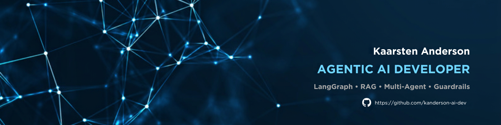

  

### I build custom multi-agent systems that your business can actually trust in production — guardrailed, evaluated, observable, and shipped with the CI/CD discipline a real company needs before an agent touches live traffic.

---

## 👋 About

I'm a **freelance Agentic AI developer**. Companies hire me to turn "we want an
AI agent" into a working, deployed service: LLM applications and multi-agent
systems built with **LangGraph**, taken from API to production.

Most agent demos break the moment real users, real money, or real data are
involved. I ship the layer above the demo:

- 🛡️ **Guardrails** against prompt injection and data leakage (OWASP LLM Top 10)
- 🧑‍⚖️ **Human-in-the-loop** approval gates that survive a restart
- 💰 **Cost-governed autonomy** — agents stay inside the budget you set
- 📊 **Evaluation scorecards** (faithfulness, cost, latency) gated in CI — measured, not vibes
- 🔍 **Observability** — tracing, structured logs and metrics to prove it works in production

**What you get:** a tested, typed, Dockerized system with a versioned quality
scorecard — not a notebook.

📄 **[Check out my projects →](PROJECTS.md)**

---

## 🛠️ Stack

**Agentic AI / LLM**

**Backend / API**

**Data**

**Frontend**

**Infra / Quality**

---

## 🚀 Featured Projects

| Project | What it does | Stack |
|---|---|---|
| **[LangGraph Multi-Agent Orchestrator](https://github.com/kanderson-ai-dev/langgraph-multiagent-orchestrator)** | Multi-tenant Supervisor–Workers platform: dynamic agent teams, runtime `Send()` fan-out, cost-governed autonomy, hash-chained audit trail | Python · LangGraph · FastAPI · SQLite · Docker |
| **[MCP Agent Toolkit](https://github.com/kanderson-ai-dev/mcp-agent-toolkit)** | MCP server + agent client: runtime tool discovery, guarded tools, prompt registry with A/B-gated promotion, LLM-as-judge scorecard | Python · MCP SDK · FastAPI · React · Docker |
| **[Agentic RAG & Knowledge System](https://github.com/kanderson-ai-dev/agentic-rag-system)** | Self-RAG loop: hybrid vector+graph retrieval, self-grading, human escalation instead of hallucinating | Python · LangGraph · FastAPI · Pinecone/Chroma · Neo4j |
| **[Guardrailed Agentic AI API](https://github.com/kanderson-ai-dev/agentic-api)** | Guardrailed single-agent service: OWASP LLM01/LLM02 defenses, multi-turn memory, SSE streaming | Python · LangGraph · FastAPI · SQLite · LangSmith |

📄 **[See the full breakdown — architecture, evaluation metrics, and links →](PROJECTS.md)**

---

### Need an agent that works in production, not just in a demo?

📩 **contact@kaarstenanderson.com** · 💼 Available for freelance Agentic AI / LLM engineering engagements

